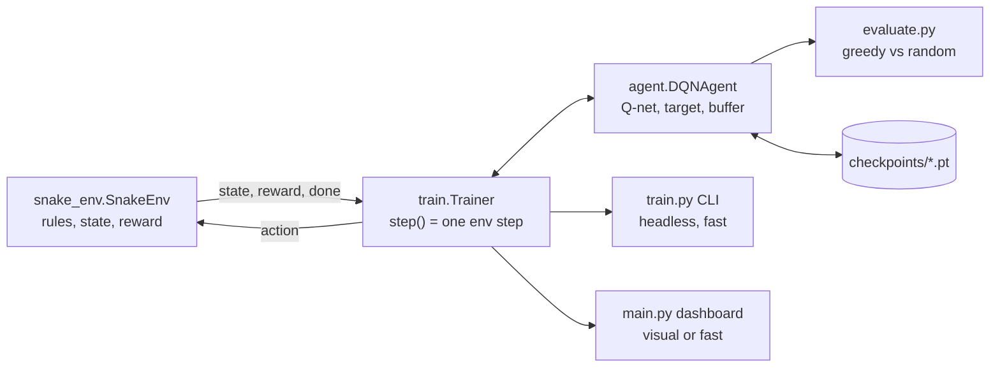

<h1 align="center">Zahhak-snakehandler</h1>

<p align="center">
  <a href="https://github.com/kheradafrouz/Zahhak-snakehandler/actions/workflows/ci.yml"></a>
  <a href="https://github.com/kheradafrouz/Zahhak-snakehandler/actions/workflows/codeql.yml"></a>
  
  
  
  <a href="https://github.com/astral-sh/ruff"></a>
  <a href="LICENSE"></a>
</p>

<p align="center">
  <b>Zahhak-snakehandler</b> learns Snake from nothing but reward signals.<br>
  Watch it live in a Pygame dashboard, or train thousands of episodes headless, on CPU or GPU.
</p>

---

## Contents
[Highlights](#highlights) · [Download Model](#download-model)· [Quick start](#quick-start) · [How it works](#how-it-works) · [CPU vs GPU](#cpu-vs-gpu) ·
[Usage](#usage) · [Dashboard](#dashboard) · [Configuration](#configuration) · [Measuring learning](#measuring-learning) ·
[Project layout](#project-layout) · [Development](#development) · [Continuous integration](#continuous-integration) ·
[Troubleshooting](#troubleshooting) · [Contributing](#contributing) · [License](#license)

## Highlights

- **Learns from experience.** Double DQN with a replay buffer, target network, Huber loss and gradient clipping. No hardcoded paths or solver.
- **Two independent speeds.** Visual mode renders the board at an adjustable rate. Fast mode simulates as quickly as the CPU allows and draws only the stats panel. Rendering never throttles training.
- **CPU, CUDA and Apple MPS.** `--device auto` picks the best available. Checkpoints are portable between devices.
- **Honest evaluation.** Greedy (epsilon = 0) evaluation on a separate seeded environment, always reported next to a random-action baseline.
- **Resumable.** Checkpoints store weights, target net, optimizer, epsilon, replay buffer and metric history, written atomically.
- **Clean separation.** Game rules (`snake_env.py`) import neither pygame nor torch. The trainer is front-end agnostic and is driven identically by the CLI and the GUI.
- **Engineering hygiene.** Tests, linting, multi-OS CI, CodeQL, Dependabot, release automation and pre-commit hooks.

## Download Model

You can obtain the official, ready-to-use version of the model from Hugging Face: [Link](https://huggingface.co/kheradafrouz/zahhak-snakehandler)


## Quick start

```bash
git clone https://github.com/kheradafrouz/Zahhak-snakehandler.git
cd Zahhak-snakehandler
python -m venv .venv && source .venv/bin/activate     # Windows: .venv\Scripts\activate
pip install -r requirements.txt                       # NVIDIA GPU? see "CPU vs GPU" below

python -m zahhak_snakehandler.train --episodes 3000             # fast headless training
python -m zahhak_snakehandler.main --watch checkpoints/Zahhak-snakehandler_best.pt   # watch it play
```

Prefer to watch it learn live? `python -m zahhak_snakehandler.main` opens the dashboard and starts training.

## How it works



| Piece | Design |
|---|---|
| **State** (14 binary floats) | Danger 1 and 2 cells ahead for straight / right / left (6), heading one-hot (4), food left / right / up / down of the head (4). The tail cell counts as free because it moves away. |
| **Actions** (3, relative) | Straight, turn right, turn left. A 180-degree reversal is impossible by construction, so no invalid moves exist. |
| **Reward** | +10 food, -10 death or starvation timeout, +0.1 moving closer to food, -0.15 moving farther. The asymmetry means circling never pays. |
| **Network** | MLP `14 -> hidden... -> 3`, ReLU. Default hidden sizes `(128, 128)`; configurable via `hidden_sizes` or `--hidden`. |
| **Learning** | Double DQN (policy net chooses, target net evaluates), Adam, Huber loss, gradient clipping, hard target sync every 500 gradient steps. |
| **Exploration** | Epsilon-greedy, 1.0 to 0.02, decayed x0.997 per episode. |
| **Starvation rule** | An episode ends after `100 x length` steps without food, preventing endless loops. |

## CPU vs GPU

**CPU**
```bash
pip install -r requirements.txt
```

**NVIDIA GPU (CUDA).** Pick the CUDA version matching your driver at <https://pytorch.org/get-started/locally/>:
```bash
pip install -r requirements-gpu.txt        # defaults to the cu121 index; edit the URL for another version
python -c "import torch; print(torch.cuda.is_available())"     # expect: True
python -m zahhak_snakehandler.train --preset gpu --device cuda --episodes 3000
```

**Apple Silicon.** The standard install supports MPS: `--device mps`.

| Preset | Hidden sizes | Batch | Buffer | `learn_every` | Best for |
|---|---|---|---|---|---|
| `cpu` (default) | 128, 128 | 64 | 50k | 2 | laptops, CI, quick experiments |
| `gpu` | 256, 256 | 512 | 200k | 4 | larger models, bigger batches |

> **Be realistic about speed.** The default network is tiny and action selection runs one state at a time, so a GPU is
> not automatically faster. Compare the `steps/s` figure in the logs for both devices and use whichever wins on your machine.

**Colab**

Execute all cells from top to bottom: [Click here to open Google Colab.](https://colab.research.google.com/github/kheradafrouz/Zahhak-snakehandler/blob/main/notebooks/Zahhak_snakehandler_Colab.ipynb)

## Usage

### Commands

| Goal | Command |
|---|---|
| Dashboard, trains live | `python -m zahhak_snakehandler.main` |
| Dashboard in fast mode | `python -m zahhak_snakehandler.main --fast` |
| Dashboard on GPU | `python -m zahhak_snakehandler.main --preset gpu --device cuda --fast` |
| Headless training | `python -m zahhak_snakehandler.train --episodes 3000` |
| Headless training on GPU | `python -m zahhak_snakehandler.train --preset gpu --device cuda --episodes 3000` |
| Resume training | `python -m zahhak_snakehandler.train --resume checkpoints/Zahhak-snakehandler_latest.pt --episodes 2000` |
| Resume in the dashboard | `python -m zahhak_snakehandler.main --load checkpoints/Zahhak-snakehandler_latest.pt` |
| Watch the trained agent | `python -m zahhak_snakehandler.main --watch checkpoints/Zahhak-snakehandler_best.pt` |
| Evaluate vs random baseline | `python -m zahhak_snakehandler.evaluate --model checkpoints/Zahhak-snakehandler_best.pt --episodes 200` |

After `pip install -e .` the same tools are available as `zahhak-gui`, `zahhak-train` and `zahhak-eval`.

### Flags

| Flag | Applies to | Meaning |
|---|---|---|
| `--episodes N` | train | Episodes to run this session (default 3000) |
| `--resume PATH` | train | Continue from a checkpoint |
| `--load PATH` | gui | Load a checkpoint and continue training |
| `--watch PATH` | gui | Loop greedy playback of a checkpoint |
| `--fast` / `--no-autostart` | gui | Start in fast mode / start paused |
| `--preset {cpu,gpu}` | all | Hyperparameter preset |
| `--device {auto,cpu,cuda,mps}` | all | Compute device (explicit choices fail loudly if unavailable) |
| `--hidden N [N ...]` | all | Hidden layer sizes, e.g. `--hidden 64 64` |
| `--seed N` | all | Random seed |

When resuming, pass the same `--preset` / `--hidden` used for training. The network shape is verified;
batch size and the other settings are not read back from the checkpoint.

## Dashboard

| Key | Action | Key | Action |
|---|---|---|---|
| `SPACE` | Start / pause / resume | `S` | Save checkpoint |
| `R` | Reset current episode | `L` | Load checkpoint |
| `F` | Toggle fast / visual mode | `E` | Watch one greedy episode |
| `UP` / `DOWN` | Faster / slower rendering | `B` | Benchmark greedy vs random |
| `ESC` | Quit (auto-saves) | mouse | Every action is also a button |

The panel shows status (Training / Paused / Evaluating / Finished), episode, total steps, score and best score,
episode reward and 100-episode average, epsilon, loss, simulation speed, device, and a live score chart.

## Configuration

All hyperparameters live in [`zahhak_snakehandler/config.py`](zahhak_snakehandler/config.py).

| Parameter | Default | Notes |
|---|---|---|
| `grid_w`, `grid_h` | 15, 15 | Board size (minimum 5x5) |
| `hidden_sizes` | (128, 128) | Network architecture |
| `lr`, `gamma` | 1e-3, 0.95 | Learning rate, discount |
| `batch_size`, `buffer_size` | 64, 50 000 | Replay settings |
| `learn_every` | 2 | One gradient step per N env steps |
| `target_update` | 500 | Gradient steps between target syncs |
| `eps_start/end/decay` | 1.0 / 0.02 / 0.997 | Per-episode decay |
| `reward_*` | see table above | Reward shaping |
| `device`, `seed` | auto, 42 | Compute device, RNG seed |
| `save_every_episodes`, `eval_every` | 100, 250 | Checkpoint and evaluation cadence |

## Measuring learning

A program that runs is not a program that learns. This project separates the two kinds of numbers:

- **Training metrics** (chart, `avg score` in logs) come from epsilon-greedy play and understate the policy.
- **Evaluation metrics** (`[EVAL ...]` log lines, `B` key, `evaluate.py`) use epsilon = 0 on a separate seeded environment
  and are printed beside a random-action baseline.

Only evaluation results tell you whether the agent learned. No benchmark numbers are shipped here because results vary by seed,
hardware and library versions. Run it yourself and record them:

| Policy | Avg score | Max score | Avg survival (steps) |
|---|---|---|---|
| Random baseline | *run `evaluate.py`* | | |
| Zahhak-snakehandler (greedy) | *run `evaluate.py`* | | |

For a fair claim, report several seeds (`--seed 1`, `--seed 2`, ...).

## Project layout

```
Zahhak-snakehandler/
├── assets/                    # logo.svg, banner.svg
├── zahhak_snakehandler/
│   ├── config.py              # hyperparameters, presets, CLI helpers
│   ├── snake_env.py           # game rules (no pygame / torch)
│   ├── agent.py               # Q-network, replay buffer, Double DQN, device handling
│   ├── train.py               # Trainer + headless CLI
│   ├── evaluate.py            # greedy evaluation vs random baseline
│   └── main.py                # Pygame dashboard
├── tests/                     # env, agent, checkpoint, config/device, evaluation, GUI smoke
├── .github/                   # workflows, issue + PR templates, Dependabot
├── Makefile, pyproject.toml, requirements*.txt, .pre-commit-config.yaml
└── README.md, CONTRIBUTING.md, CODE_OF_CONDUCT.md, SECURITY.md, CHANGELOG.md, LICENSE
```

## Development

```bash
pip install -r requirements-dev.txt
pre-commit install          # optional: lint on every commit
make test                   # pytest
make cov                    # with coverage
make lint                   # ruff
make smoke                  # 30-episode train + evaluate round trip
make help                   # list all targets
```

## Continuous integration

| Workflow | What it does |
|---|---|
| **CI** | Lint (ruff), tests on Ubuntu x Python 3.9 to 3.12 plus Windows and macOS, package build + `twine check`, end-to-end smoke (train, resume, evaluate, GPU preset on CPU), and a single required `CI passed` gate for branch protection. Concurrent runs on the same ref are cancelled. |
| **CodeQL** | Static security analysis on push, PR and weekly. |
| **Release** | Pushing a tag `vX.Y.Z` verifies it matches `pyproject.toml`, builds sdist + wheel, and publishes a GitHub release with notes. |
| **GPU check** | Manual workflow for a self-hosted `gpu` runner: confirms CUDA is visible and trains briefly with `--device cuda`. |
| **Dependabot** | Weekly updates for GitHub Actions and pip dependencies. |

Suggested branch protection on `main`: require the **CI passed** check and a pull request review.

## Troubleshooting

| Problem | Fix |
|---|---|
| No window on Linux / WSL / SSH | Use `train` and `evaluate` headless, or run an X server (WSLg works). |
| `torch.cuda.is_available()` is False | You installed the CPU wheel or the CUDA version mismatches your driver. Reinstall from the matching PyTorch index and update NVIDIA drivers. |
| `weights_only` error in `torch.load` | Upgrade to torch >= 2.0. |
| Training is slow | Raise `learn_every`, lower `batch_size`, try `--hidden 64 64`, keep `num_threads = 1` on CPU, use fast mode or headless training. |
| GUI laggy in fast mode | Lower `fast_budget` in `config.py` (e.g. 0.015). |
| Scores plateau low | Train longer, set `eps_decay = 0.998`, try other seeds. DQN results vary between runs. |
| Hidden-size mismatch on resume | Pass the same `--hidden`. `--watch` and `evaluate` read the architecture from the checkpoint. |

## Contributing

Contributions are welcome. Please read [CONTRIBUTING.md](CONTRIBUTING.md) and the [Code of Conduct](CODE_OF_CONDUCT.md).
Report security issues privately as described in [SECURITY.md](SECURITY.md).

## License

[MIT](LICENSE)
